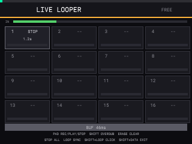

# Live Looper

A 16-pad live looper that runs inside the stock app: each pad records a loop from
the sampler's **selected input source**, plays it back through the app's **audio
output**, and the whole thing is drawn as its own fullscreen view. It is pure
mod code — no firmware file changes, and closing the view leaves the app exactly
as it was.

## Where it lives



`SHIFT` + `DATA` opens **SAMPLE OPTIONS**, `DATA` selects **Live Looper**, `DATA`
confirms. The view covers the whole 320×240 screen; the stock page keeps painting
underneath, which is why the view has to repaint itself (a small thread forces a
repaint every 60 ms while it is open).

```
┌──────────────────────────────────────────────────────┐
│ LIVE LOOPER                          SYNC 1.27s  ●   │  header + beat dot
│ IN ██████░░░░░░░░░░░░░░░░░░░░░░░░░░░░░░░░░░░░░░░░░░   │  input level
│ ┌────────┐ ┌────────┐ ┌────────┐ ┌────────┐          │
│ │1  REC  │ │2  PLAY │ │3  --   │ │4  --   │          │  4×4 pad grid
│ │▓▓▓▓▓░░░│ │1.3s ▓▓ │ │        │ │        │          │  length / playhead
│ └────────┘ └────────┘ └────────┘ └────────┘          │
│  ...                                                 │
│            PAD: REC/PLAY/STOP  SHIFT+PAD: OVERDUB     │
│            LOOP: SYNC PULSE   SHIFT+DATA: EXIT        │
│▓▓▓▓▓▓░░░░░░░░░░░░░░░░░░░░░░░░░░░░░░░░░░░░░░░░░░░░░░░░│  pulse bar
└──────────────────────────────────────────────────────┘
```

Each cell shows the pad number, its state (`--` empty, `REC`, `PLAY`, `DUB`,
`STOP`), the loop length in seconds, and a bottom strip: how much has been
captured while recording, where playback is while playing.

## Controls

| control | action |
|---|---|
| pad | empty → **record**; recording → **play**; playing → **stop**; stopped → **play** |
| `SHIFT` + pad | **overdub** (adds the input to the existing loop); the next pad press returns to playback |
| `ERASE` + pad | **clear** that pad's loop |
| `STOP` | stop every loop, keeping the material |
| `LOOP` | **sync pulse** on/off, with the length of the most recently recorded loop |
| `SHIFT` + `LOOP` | **metronome click** on/off (off by default) |
| `ERASE` + `LOOP` | clear all loops and the pulse |
| `K1` | trim the record latency, 1 ms per step (shown as `LAT ±N ms`) |
| `SHIFT` + `DATA` | close the view and return to the previous page |
| every other button | consumed while the view is open |

The pads are owned by the looper while it is open: their note events are dropped
at the app's note entry, so no sample is triggered underneath. `SHIFT` is also
kept from the app, because the firmware pairs `SHIFT` with a pad press for its
own shortcuts (**Full Level**) — a leaked shortcut popped a dialog over the
looper before this was fixed.

## Behaviour details

* **Loop length** is an exact number of played frames. The first press starts
  recording, the second closes the loop and starts playback from the top. A loop
  can be up to **8 seconds**, is **mono**, and is mixed at 0.85 with a hard
  clamp at full scale.
* **Overdub** keeps the loop length and adds the input into the existing buffer,
  so the material already there stays and the new pass layers on top.
* **Sync pulse** uses the length of the last recorded loop as its period. While
  it is on:
  * the header dot, the pulse bar and the sync message show the beat; the
    **click is off by default** (`SHIFT`+`LOOP` turns the audible 1 kHz click on,
    the header then reads `SYNC … +CLK`);
  * every newly closed loop is quantized to a **whole multiple** of the pulse.
    The nearest multiple wins, and if that would drop more than 1/8 of a pulse
    the next multiple is used instead, so recorded material is never silently
    truncated. The tail is padded with silence, so `length` is always a multiple
    of the pulse even when the take was shorter (`rec < length`).
* **MAIN VOLUME** scales the loops exactly like the rest of the app: the knob's
  CC (19) is tracked and applied as a gain on the loop mix, and the value is
  stored in `/data/minimod-looper.cfg` so it survives a restart.
* **Overdub** clamps each sample to full scale, so an input that hears the
  output cannot grow a loop without bound.
* **Closing** the view stops all playback and clears the pulse but keeps the
  recorded loops in RAM; reopening shows them as `STOP` and they can be played
  again. They are not saved to disk and do not survive an app restart.

## How it works

### Input: the selected source, without owning the device

The firmware's capture stream is `RW_INTERLEAVED`, `S32_LE`, **4 channels,
44.1 kHz** (`/proc/asound/Loopback/pcm0c/sub0/hw_params`), and the app reads it
through `snd_pcm_readi`/`snd_pcm_readn` from libasound. The mod is already an
`LD_PRELOAD` library, so it **exports those two symbols itself** and forwards to
the real functions through `dlsym(RTLD_NEXT, ...)`:

```c
long snd_pcm_readi(void *pcm, void *buffer, unsigned long size)
{
    long got = real_snd_pcm_readi(pcm, buffer, size);
    if (got > 0 && looper_is_open())
        looper_input_s32_interleaved(buffer, g_pcm_channels, got);
    return got;
}
```

`snd_pcm_hw_params_set_channels` is interposed too, only to learn the channel
count the app asked for. This records exactly what the sampler hears, whichever
input source is selected, without opening a second device (which the app already
holds) and without touching the app's own read path.

Two later read attempts were abandoned and are worth remembering: hooking
`FUN_04039450` (the S32 → planar converter) never fired, and patching the
`snd_pcm_readn` call site at Ghidra `0xefbaa4` never fired either — the app's
live input path is not the one those belong to. Symbol interposition is the part
that works for every read in the process.

### Output: mixed into the device block

The firmware's output writer (`FUN_040398f0`, mod offset `0x3f398f0`) turns
planar float channels into interleaved S32 and calls `snd_pcm_writei`. The
looper interposes `snd_pcm_writei` as well and adds its loops to that interleaved
block immediately before the real write:

```c
if (looper_is_open() && buffer && size)
    looper_render_s32(buffer, channels, size);
```

Mixing there instead of in the planar writer hook means the loops land on the
device no matter which device object rendered the app's own sound, and it is the
same block a hardware jack would receive.

### Latency: the firmware's own ring geometry

The firmware opens its capture and playback streams as one linked duplex device
on the same clock, so what it has buffered is exactly the recording latency: one
full ring of input that was captured but not yet consumed, plus one full ring of
output that has been written but not yet played. That is the number the sampler
itself works with, and the looper reads it straight from ALSA with
`snd_pcm_hw_params_get_buffer_size` on both of the firmware's handles — no probe,
no return path, so **headphones, USB audio and a silent instrument input all get
the right value**. The sizes are re-read every few seconds in case the device
reopens with a different buffer (USB, headphones).

In the lab the firmware uses 1024 frames per ring, so the looper applies
`2048` frames (46 ms); a click recorded through the loop cable lands **69 frames
(1.6 ms)** from the expected pulse grid. The strip shows `BUF 46ms`.

The sizes are read with `snd_pcm_hw_params_current` **on the stream's own audio
thread** (the first write/read after the view opens) and the channel count used
for mixing comes from the same query, never from a guess: touching the app's pcm
from the repaint thread is exactly the kind of thing that can wedge ALSA and take
the whole app down when the view closes.

`K1` adds a trim of ±400 ms on top for the room or personal preference, stored in
`/data/minimod-looper.cfg` and reused at the next start (the strip then shows
`BUF` with the trimmed total). If the firmware ever reports no buffer geometry,
the mod falls back to `snd_pcm_delay` + `snd_pcm_avail` (`EST`), and
`MINIMOD_LOOP_LAT=<frames>` forces a fixed value for experiments.

The compensation is snapshotted when a take starts and used for the whole take:
a new recording drops its first `lat` frames (they belong before the loop start)
and overdubs write `lat` frames earlier, wrapping inside the loop.

### Clock and threads

The output frames are the clock. Recording consumes input frames from a
lock-free SPSC ring (0.74 s) at the rate the output block advances, so a loop is
always an exact count of played frames even though input and output are separate
audio streams. If the input runs ahead the oldest frames are dropped; if it runs
short the missing frames are recorded as silence.

| thread | what it does |
|---|---|
| input (ALSA read interposition) | converts S32 → mono float, pushes into the ring, updates the input level |
| output (`snd_pcm_writei`) | mixes loops, records/overdubs, advances the transport, renders the sync click |
| control surface (`buttons`, `note_on`) | pad state changes only, no model access |
| UI (paint hook) | reads an atomic snapshot and draws; never blocks the audio threads |

Nothing allocates or locks on an audio thread: the loop pool (16 × 8 s mono
float = 22.6 MB) is `mmap`ed once when the view opens and touched from the
control thread before a take starts.

## Verification (emulator)

```sh
python3 mod/tests/emulator_looper.py --lab ~/projects/customs/virtual-mpc-sample
```

The test drives the panel and reads the mod's own state and output tap from
`/proc/<pid>/mem`; it needs a freshly started app (the looper view starts empty).
Last run on the release build:

```
live looper: loop 51968 frames (1.18s), 0.150 rms at 441 Hz, ring 2048 frames,
take latency 2048 frames, sync 51968, quantized 25600 -> 51968
```

What that covers, in order: opening the view reads the firmware's ring geometry
for the latency; the menu entry opens a fullscreen view
with 16 empty pads and the click off; a pad records ~1 s from the tone input and
closes into `PLAY` with a compensation equal to the ring geometry; after the input
is unplugged the device output still carries the recorded 440 Hz at 0.15 rms
(`441 Hz` by zero crossings); a second press stops it and the output goes silent;
`SHIFT`+pad reaches `DUB` and the next press returns to `PLAY` with the length
unchanged; `LOOP` sets the pulse to the last loop length and a short take is
quantized to exactly one pulse with `rec < length`; `STOP` silences everything;
`ERASE`+pad clears one pad; `SHIFT`+`LOOP` toggles the click both ways; the
loops follow `MAIN VOLUME` (half the knob gives roughly half the level);
`SHIFT`+`DATA` closes the view, the loops survive, the app does not restart and
its pid is unchanged.

The tap is the last two seconds of audio the app handed to the device
(`g_outtap`, `g_outtap_w`). It exists because the lab's host PCM socket
(`ws://127.0.0.1:5557`) reported **silence while the app was writing non-silent
audio**: with a pad held, the in-process write peak read 1.0 and the bridge's
`out` levels stayed 0.0. That is a lab capture-path issue, not a mod issue, but
it means host-side PCM is not a trustworthy acceptance signal in this lab — the
in-process tap is.

## Limits and known issues

* Mono loops, 8 s maximum, no undo. The 44.1 kHz constant is only used for the
  seconds readout; looping itself is frame-based.
* The ring geometry is a property of the device's audio path, so it applies to
  every source. `K1` covers acoustic round trips outside the firmware (a room
  mic, an external converter) and is remembered in `/data/minimod-looper.cfg`.
* **The app's hidden page selection still follows the last pad press.** Pad
  events are dispatched to the app's observer listeners upstream of the note
  handler, and the pad-grid selection is one of those siblings. Blocking the
  whole dispatch (`FUN_020ce3e0`, mod `0x1fce3e0`) does stop the selection
  change, but it also stops the looper from ever seeing a pad — so it was
  reverted. Audio is fully blocked; only the selection moves.
* **Input monitoring is not muted.** If the app monitors the input, you hear the
  source and the loop together while recording. The looper only records what the
  sampler hears.
* The sync pulse is length-based, not tempo-based: there is no BPM grid, so
  "synced" means "an integer number of the last loop's length".
* Loops live in RAM only; an app restart loses them.

## Related

* [`docs/MINIMOD.md`](MINIMOD.md) — current shipped behaviour.
* [`docs/re/FIRMWARE-MECHANISMS.md`](re/FIRMWARE-MECHANISMS.md) — the audio
  mechanisms this relies on.
* [`mod/tests/emulator_looper.py`](../mod/tests/emulator_looper.py) — the
  acceptance test.
