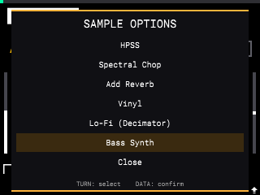
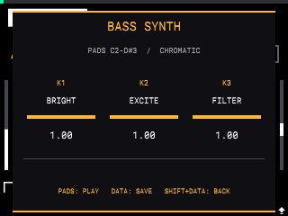
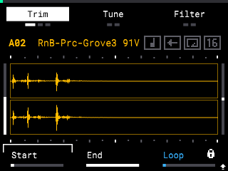

# Bass Synth sample generation

## Current behavior

In Sample Mode, open **SAMPLE OPTIONS** with `SHIFT` + `DATA` and choose
**Bass Synth**. The parameter page maps K1 to harmonic brightness, K2 to drive,
and K3 to the low-pass filter. Press `DATA` to generate one centered stereo C2
(MIDI 36) pluck and assign it to the next empty pad through the stock Extract
command. The note rings for 1.5 seconds; its key-down portion is 400 ms. The
selected pad's source sample is not rewritten. While the parameter page is
open, pads 1–16 audition C2 through D#3 in chromatic semitones. Knob changes
reshape notes that are already ringing as well as notes played afterwards.

## Emulator screenshots

## Live pad audition

Pad note-on and note-off are intercepted through the existing native hooks
(`FUN_01e27360` and `FUN_01e270d0`, Ghidra VAs `0x1f27360` and `0x1f270d0`).
In Bass Synth mode, note-on queues the pad index and velocity; note-off is
consumed because the DaisySP string is a pluck with a natural decay.

The audio mix uses the firmware's writer `FUN_040398f0` (Ghidra VA
`0x040398f0`, mod offset `0x03f398f0`). It receives planar float channels before
converting them to S32 PCM and calling `snd_pcm_writei`. The hook copies up to
eight channels and 2,048 frames into thread-local scratch, mixes up to four
DaisySP StringVoice/SVF voices into the first two channels, then calls the
original writer with that private block. It leaves the firmware's source audio
buffers untouched and uses no locks or heap allocation in the audio thread.
K1/K2/K3 values are published atomically and applied at each audio block, so
brightness, excitation and filter changes affect active voices live.

On November 6, 2026, emulator pads 1 and 16 queued two note events and the
native audio hook mixed nonzero preview output (peak `0.383`); the app remained
up with `NRestarts=0`. With K1/K2/K3 at `1.0`, a subsequent C2 preview reached
peak `0.272`. The hooked output was confirmed in the firmware audio-writer
buffer; the emulator run did not assess acoustic output through physical
hardware speakers.

To repeat: preload the built `mod/build/minimod.so`, open Sample Mode, press
`SHIFT`+`DATA`, turn DATA five detents to Bass Synth, and press DATA. Press pad
1 and pad 16; turn K1–K3 while holding the page open, then press more pads.
The telemetry symbols `g_bass_preview_notes`, `g_bass_preview_blocks` and
`g_bass_preview_peak_bits` in `build/minimod.elf` confirm note events and
nonzero audio blocks in `/proc/<pid>/mem`; `g_bass_knob` confirms live control
values.

The November 6 production rebuild rerun reported preview active/available,
three pad note events, 2,236 nonzero mixed audio blocks, a measured writer
buffer peak of `0.512`, K1/K2/K3 all at `1.0`, and `NRestarts=0`.

The renderer is DaisySP's `StringVoice` Karplus-Strong physical model and its
state-variable filter, wrapped by `mod/src/bass_sample.cpp`. The minimal DaisySP
source subset is vendored under `mod/third_party/daisysp/Source` from upstream
revision `2c72eaf9eac5fc0dca1919d65d606da907832618`, with its license in
`mod/third_party/daisysp/LICENSE`. No runtime library is added.

K1 sets string excitation brightness and damping. K2 adjusts accent, string
structure, and filter drive. K3 maps exponentially from 700 Hz to about 16.8 kHz
(or 45% of sample rate, whichever is lower). The model is triggered once at C2;
after the 400 ms key-down portion, a gentle exponential fade shapes the tail.
The centered stereo output is peak-scaled to 0.86 and written as float32 through
the existing Extract writer substitution. The renderer does not instantiate
the unresolved firmware FMBass class. The UI thread still owns pad validation and
Extract; generation runs in the existing transform worker. The emulator showed
that Extract's firmware save path can dither the source WAV's 24-bit PCM by one
least significant bit while creating the destination. Bass Synth snapshots the
source `data` chunk before processing and restores those exact audio bytes after
Extract, then syncs the file. Non-audio `atem` metadata remains under firmware
ownership.

## Firmware FMBass boundary

Ghidra identifies the native FMBass factory as `FUN_03d45d50` (file offset
`0x3d45d50`), registered by `FUN_03d46910`. It allocates a `0x3980` object and
calls constructor `FUN_03e0af30`. Its vtable is at `0x07185c18`; slot 9 prepares
the audio engine, slot 11 renders, slot 13 handles instrument events, and slot
21 updates parameters. Its 94 parameter descriptors start at `0x072acc20`.

The H3 instrument constructor is not standalone like the H3 effect classes.
The factory receives the H3Patch host as its first argument and the audio
context as its second argument. The constructor calls `FUN_03cedde0` on the
host. That function queries the required `H3pp` interface (`0x48337070`)
through host vtable slot 4 and stores the returned service in the instrument.
Passing the effect context as the host caused the earlier emulator crash.

The normal creation path in `FUN_03cf5180` calls the registry with the patch
object as host and `patch[2]` as audio context, then sends `H3pc` and `H3ps`
messages to the new part. FMBass setup at `FUN_03e06200` reads the sample rate
at offset `0`, block size at `8`, and timing doubles at offsets `0x30` and
`0x38`. `FUN_03d30c00` initializes the firmware's 0x60-byte context object;
that size covers every observed FMBass read. Its exact semantics and offline
construction lifecycle still need runtime verification.

The setup payloads are now identified from the patch parser: `H3pc`
(`0x48337063`) receives the parsed part record at length `0x10`, and `H3ps`
(`0x48337073`) receives the patch setup block at `patch + 0x10`, length
`0x74`. The effect-wrapper path constructs the patch through
`FUN_03d27800`; its host context object is initialized by `FUN_03d30c00` and
is `0x60` bytes, large enough for the observed FMBass context reads. The
firmware creates an H3Patch host with `FUN_03d27800`, then builds the inner
0x1990-byte patch with `FUN_03d28620` / `FUN_03cef240`. A direct offline
construction path still needs validation, including teardown and any patch
graph initialization required before audio setup.

The parser input is ordinary XML bytes: `FUN_03d2b020(xml, length)` parses the
document tree. `FUN_03d28620(wrapper, xml, length)` allocates the 0x1990-byte
inner patch, initializes it with wrapper context/settings, then passes that
document to `FUN_03cf1a20` for state parsing. The stock effect wrapper uses
this flow with an `<H3Patch><H3Part Type='...'>` document. This creates valid
H3Part nodes through firmware code rather than fabricating the 16-byte `H3pc`
node record. The outer graph prepare method is `FUN_03d28390`; audio must be
processed through the outer wrapper's `FUN_03d27ca0` with planar input/output
channel arrays. The inner patch's `FUN_03ceea40` is called by this wrapper with
its internal audio context; calling it directly with caller buffers is not the
normal graph path.

The patch's query method `FUN_03cf1d60` handles `H3pp` by returning the
patch itself and setting the reported size to 8. This identifies the returned
object, but does not establish which of its other methods or fields FMBass uses.

The inner patch vtable is based at `0x071726e8`: slot 2 (`+0x10`) is the
message/state dispatcher `FUN_03cf1a20`, and slot 4 (`+0x20`) is the `H3pp`
query `FUN_03cf1d60`. The owning graph wrapper has a separate vtable at
`0x071752f0`; slot 9 creates the inner patch via `FUN_03d28390`, slot 11
processes it via `FUN_03d27ca0`, and slot 33 (`+0x108`) builds it via
`FUN_03d28620`. The sample-rate context is initialized by `FUN_03d30c00` as
part of wrapper construction. Thus the minimum known native graph setup is the
0x60-byte initialized context, a 0x1990-byte inner patch initialized with
`FUN_03cef240`, and the H3Patch setup messages. Teardown and offline render
equivalence remain to be validated.

Useful parameter indices from Ghidra are Harm2 `1`, Distortion `8`, Filter
Cutoff `27`, Amp Attack `38`, Amp Decay `39`, Amp Sustain `40`, Amp Release
`41`, Polyphony `78`, and Master Volume `83`. Although Ghidra decompiles the
parameter setter's first argument as `undefined4`, ARM64 instructions show it
is a float in `s0`; the object pointer and parameter index occupy `x0` and
`x1`. Passing float bits as an integer crashes in the setter.

### Native-render investigation and remaining gap

The device-native route is still not safe to ship. The native XML graph can be
constructed and prepared, but its standalone note dispatch is intermittent and
successful dispatch still produces exact digital silence. Production uses the
DaisySP renderer in `mod/src/bass_sample.cpp`; native FMBass must remain
separate until an emulator run proves audible output with a measured C2 peak.
The native probe remains in `mod/src/fmbass_sample.c` and must not be linked into
the release build while these failures remain.

Ghidra resolved the firmware voice path and corrected two earlier assumptions.
The FMBass part's 12-voice manager is at instrument `+0xc0` and its allocated
group count is at manager `+0x68`. The event ring is at instrument `+0x358`
(size `0xe58`); read index `+0xe10`; callback closure `+0xe28`; invoker
`+0xe30`; active flag `+0xe38`. The standalone host callback at instrument
`+0x38` is null after prepare, so a correctly ABI-shaped acceptance callback is
needed to enqueue test notes. Before calling the event pump, verify both the
closure and invoker are non-null: `FUN_03e0c1a0` dereferences the closure and
calls the invoker. Its Ghidra VA `0x3e0c1a0` must be converted to runtime offset
`0x3d0c1a0` because the loaded firmware image base is `0x100000`. The earlier
`0x3dfc1a0` attempt was an arithmetic mistake; calling the wrong address caused
a crash in unrelated code.

When the corrected pump works, `FUN_03e0eb60` routes note-on to instrument
slot 42 (`FUN_03e0ed60`), which acquires a voice group through manager slot 2
(`FUN_03e0d0a0`). Group note-on fan-out is `FUN_03e0b430`. The child voice
vtable base is `0x06ed2040`: entry `+0x10` (`FUN_03e068f0`) initializes the
voice DSP on note-on; entry `+0x20` (`FUN_03e060a0`) updates pitch/velocity;
entry `+0x48` (`FUN_03e08840`) renders audio. The FMBass part render
(`FUN_03e06450`) walks active groups and calls each group's render entry at
`+0x48`. Thus the event reaches a valid child and includes the DSP initialization
path; the earlier theory that dispatch only set pitch was wrong.

Parameter descriptor defaults are not silent: Amp Attack 0, Amp Decay 0.6,
Amp Sustain 1.0, Amp Release 0.1, Master Volume approximately 0.707. Explicitly
setting an audible amp envelope and master level did not change the zero output,
so missing defaults are disproved as the root cause.

Emulator evidence on November 6, 2026:

- One corrected-pump run drained note-on and note-off (read index advanced to 1
  and 2), allocated one group with one child and valid instrument back-pointer,
  remained alive (`NRestarts=0`), but first-block and full-render peak were 0.
- A later guarded probe confirmed queue closure and invoker were non-null and
  again allocated one active group, then returned a processing error because
  full output peak was 0. Other attempts crashed intermittently during event
  dispatch even when those pointers were present. A closure-null guard makes
  those cases fail cleanly, but does not solve the intermittent dispatch fault.
- `FUN_03e06450` checks group state byte `+0xb` before rendering. The observed
  group flag is clear, so group stop state does not explain silence.
- `FUN_03d27ca0` walks the wrapper render-node list at graph `+0x88`. It was
  null after prepare for both minimal FMBass XML and the exact embedded
  firmware preset. The FMBass child DSP countdown at voice `+0x3dc` stayed at
  1 after graph processing. This generic effect-chain graph therefore never
  invokes the instrument renderer. Direct calls to part slot 11 from the probe
  are not a safe workaround: one attempt crashed, and a later same-buffer
  comparison did not reach the render call because queue dispatch crashed
  first.
- Ghidra identifies `H3MPCInstance` RTTI at `0x06fa3cf0`. Its vtable entries
  route process to `FUN_03d27ca0` and build to `FUN_03d28620`, the same generic
  wrapper path. `H3MPCSynthBase` at `0x06fa3eb8` is an audio-plugin class with
  12 bases, including `H3MPCInstance`, `VoiceManageable`, audio-plugin
  parameter interfaces, an observer, and `juce::Timer`. The nearby
  `H3MPCVoiceManagedInterface` vtable is abstract and exposes voice-management
  callbacks. This locates the larger MPC plugin hierarchy, but does not yet
  identify a supported offline constructor/render lifecycle that hosts an
  FMBass H3Part.
- `H3MpcSynthDemo` is a separate synth implementation. Its constructor
  initializes its own synth voices and parameter table; it is not evidence
  that the FMBass part can be rendered through the generic effect wrapper.

The current firmware feature is therefore operational through the DaisySP C2
renderer: controls, background generation, stock Extract assignment, exact
source audio restoration, and emulator validation all work. Native FMBass is a
separate unresolved enhancement; do not label it as working until output is
nonzero and the emulator confirms C2, pad assignment, source preservation, and
no restart. The confirmed and disproved hypotheses are in `HYPOTHESES.csv` and
[`FIRMWARE-MECHANISMS.md`](FIRMWARE-MECHANISMS.md).

#### Probe chronology

1. Directly constructing FMBass with an effect context crashed because its host
   must answer the `H3pp` interface. XML graph construction fixed the host.
2. The setter's value is passed in ARM64 `s0`; passing float bits as an integer
   crashed. Correct float calling convention plus graph processing stayed up
   but emitted silence.
3. A null instrument callback rejects the note before queue insertion. A fake
   callback with the observed ABI permits enqueue.
4. Ghidra image-base correction fixed the queue pump address. A successful
   drain allocated an active voice group, but produced silence; later dispatch
   attempts were intermittent. The child vtable shows note-on DSP init and
   audio rendering are distinct from pitch update, disproving the pitch-only
   theory.
5. Parameter-table defaults and explicit Amp/Master settings do not explain
   silence. The group render-state flag is clear. The decisive graph check
   found `graph+0x88 == NULL`, so the generic wrapper never calls FMBass.
6. Ghidra located the `H3MPCInstance` and `H3MPCSynthBase` plugin hierarchy.
   The former still uses the generic graph process/build methods; the latter
   inherits that wrapper and voice-management interfaces. The concrete MPC
   synth host lifecycle and its FMBass render call remain unidentified.

Never infer a working native synth from factory success, a nonzero queue write,
or voice allocation alone. Require nonzero rendered samples and a measured C2
fundamental first.

## Validation

`mod/tests/emulator_bass_sample.py` opens the menu, sets all three knobs,
renders the sample, checks the WAV and C2 spectral peak, verifies the source WAV
audio data is byte-identical, confirms the new output is assigned by native Extract, and checks
the app PID and restart count. The November 5, 2026 run passed at 44.1 kHz with
a measured 65 Hz peak and no restart.

The November 6 rerun against the rebuilt production library also passed: output
was 66,150 stereo frames at 44.1 kHz, the measured peak was 65.00 Hz, RMS was
0.35578, the destination pad was assigned, and the emulator reported no restart.

The test currently covers the production DaisySP renderer. Native FMBass probes
were separately run on November 6, 2026: the graph-wrapper version with the
corrected float setter ABI stayed up but produced silence; the corrected event
pump sometimes allocated a valid voice group, but intermittently crashed during
dispatch. Ghidra then showed that the generic graph has no render node for the
FMBass part, and its voice DSP countdown does not advance. Attempts to call the
part renderer directly are not validated or safe to ship. After rebuilding the
production library without the probe, the emulator passed again: `Bass C2.wav`,
65.00 Hz peak, 66,150 stereo frames at 44.1 kHz, RMS 0.35578, assigned pad,
source audio preserved, unchanged PID, and `NRestarts=0`. Native FMBass remains
unresolved; production continues to use DaisySP.
